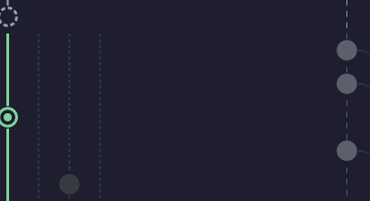
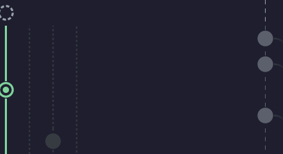

# ease-pass/20 — the pinned uncommitted row, before and after

Pixel tier only, and only while the uncommitted row is pinned at the top with `HEAD` scrolled off. `TeamSpec::MONOREPO`,
187x50, 17x37 cell, `j` x60. The top six pane rows of the graph column over a stand-in dark background. Colour is
unverified: these are premultiplied RGBA over `#1E1E2E`, not what Ghostty paints. Judged by the user's eye.

Right looks like: the pinned uncommitted row identical in both; in the after, the history row directly under it has its
lanes and its commit's upward line running to the top edge of the row; every other row identical. Colour unverified.

**What the pixels actually show (measured, `docs/shots/ease-pass/` before vs after, 1218 differing pixels of 90,576):**
the history rows under the pinned row differ only along the lane columns (x 7-9, 41-43, 75-77, 109-111): dotted lanes
reach the top edge of the row under the pinned row. And the pinned row itself is *not* pixel-identical: its top 4 pixel
rows lose a short grey stub (x 7-9, y 0-3) at the dashed ring's top edge. Before, that stub was the row above the
pinned row's neighbour in history reaching into it; it is drawn from a row that is off screen. After, the dashed ring
stands alone on the pane's first line. The ruling expected an identical pinned row; the one-row image has no row above
it, which is the point of the change (its key can no longer depend on where the viewport is).

## Before (3123840e: the pinned row sits inside its strip)

## After (the pinned row is an image of its own)

